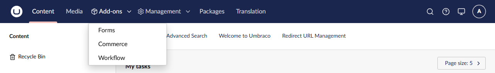

# Grouped Navigation

Group Umbraco backoffice sections into dropdowns in the top navigation, driven by `appsettings.json`.

Presentation only: grouping never grants or hides access. Sections still come from the user's group permissions and manifest conditions, and Umbraco's own route guards still apply.


## Install

```
dotnet add package HCS.UmbCustomHeader
```

Requires Umbraco CMS 17.x.

## Configure

```json
{
  "HCS": {
    "UmbCustomHeader": {
      "Enabled": true,
      "Groups": [
        {
          "Alias": "management",
          "Label": "Management",
          "Icon": "icon-settings",
          "Sections": [ "Umb.Section.Settings", "Umb.Section.Users", "Umb.Section.Members" ]
        }
      ]
    }
  }
}
```

Environment variables use the same path with double underscores, for example `HCS__UmbCustomHeader__Enabled=false`.

The dropdown lists only the sections the current user can access:



| Setting | Notes |
|---|---|
| `Enabled` | `false` restores the native navigation. |
| `Alias` | Unique per group. |
| `Label` | Text or a localisation key such as `#groupedNav_management`. |
| `Icon` | Optional icon alias shown beside the label. |
| `Weight` | Optional. Places the group by weight among top-level items (higher first) instead of at its first member. |
| `Sections` | Section aliases, in dropdown order. Unknown or inaccessible aliases are ignored. |

Section aliases (checked against Umbraco 17.7 with Forms 17.6, Commerce 17.2 and Workflow 17.5):

| Section | Alias |
|---|---|
| Content, Media, Settings, Packages, Users, Members, Translation | `Umb.Section.<Name>` (Users is `Umb.Section.Users`, Members is `Umb.Section.Members`) |
| Forms | `Umb.Section.Forms` |
| Workflow | `Umb.Section.Workflow` |
| Commerce | `commerce` |

Rules:

- A group with no visible members is removed; with one visible member it renders as that section's plain tab.
- A section listed in more than one group belongs to the first group only.
- Invalid config (duplicate aliases, empty labels or sections) is logged and the native navigation is used.
- Edits apply on the next backoffice load.

The package replaces the header's `render` method, as Umbraco has no extension point for header sections. If the header's structure changes, or another package already patched it, the package logs a warning and leaves the native navigation in place.
